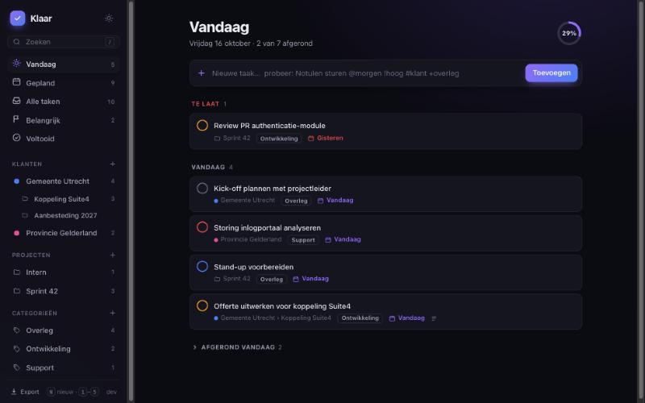

# Klaar ✓

Een strakke, self-hosted todo-app voor werk. Eén kleine Docker-container, geen externe afhankelijkheden, je data in één SQLite-bestand.



## Features

- **Slimme weergaven**: Vandaag (incl. te laat), Gepland (per dag gegroepeerd), Alle taken, Belangrijk, Voltooid
- **Klanten, projecten en categorieën** om je werk te scheiden (zie hieronder)
- **Snel invoeren** in één regel:
  `Notulen sturen #gemeente +overleg @morgen !hoog`
  - `@vandaag`, `@morgen`, `@overmorgen`, `@vrijdag` / `@vr`, `@volgendeweek`, `@20-10`, `@2026-10-20`
  - `!hoog` / `!middel` / `!laag` (of `!3` `!2` `!1`)
  - `#naam` voor een klant of project, `+naam` voor een categorie; meerdere `+` mag (begin van de naam is genoeg)
- **Detailpaneel** met notities, deadline, prioriteit, klant, project en categorie-labels (slaat automatisch op)
- Voortgangsring voor vandaag, afvinken met ongedaan maken, slepen om te sorteren
- Licht/donker thema, werkt op mobiel en is als app te installeren (PWA)
- Sneltoetsen: `N` nieuwe taak, `/` of `⌘K` zoeken, `1`–`5` wissel weergave, `Esc` sluiten
- JSON-export via de zijbalk
- Optioneel wachtwoord (HTTP basic auth)

## Klanten, projecten en categorieën

| Wat           | Betekenis                        | Voorbeeld                         |
| ------------- | -------------------------------- | --------------------------------- |
| **Klant**     | Voor wie je het werk doet (met eigen kleur) | Gemeente Utrecht, Provincie |
| **Project**   | Een klus, optioneel onder een klant | Koppeling Suite4, Sprint 42    |
| **Categorie** | Labels: wat voor soort werk het is | Overleg, Ontwikkeling, Support  |

- Een taak heeft hooguit één klant en één project, maar zoveel categorieën als je wilt. Klik in het detailpaneel op een label om het aan of uit te zetten, of maak er direct een nieuwe aan met **+ Nieuw**.
- Alleen klanten hebben een kleur; projecten en categorieën zijn neutraal, zodat de kleur altijd betekent: voor wie is dit.
- Kies je een project dat bij een klant hoort, dan krijgt de taak automatisch die klant. Kies je een andere klant, dan vervalt het project van de oude klant.
- Projecten zonder klant (bijv. intern werk) staan in de zijbalk onder *Projecten*; projecten van een klant staan onder die klant.
- De klantweergave groepeert taken per project. Een categorie loopt dwars door alle klanten heen, zodat je bijvoorbeeld al je overleggen bij elkaar ziet.
- Sleep een taak naar een klant of project in de zijbalk om hem te verplaatsen, of naar een categorie om dat label toe te voegen.

## Starten

Images staan op GitHub Container Registry als `ghcr.io/richrdj/todo` (amd64 + arm64, dus ook voor een Raspberry Pi of Synology).

| Tag                 | Wat                                                  |
| ------------------- | ---------------------------------------------------- |
| `latest`            | Laatste release                                      |
| `1.2.3` `1.2` `1`   | Vaste release (`1` volgt automatisch 1.x-updates)    |
| `edge`              | Laatste commit op `main`, ongetest                   |

### Docker stack (Swarm / Portainer)

```bash
docker stack deploy -c stack.yml klaar
```

Een vaste versie kiezen:

```bash
KLAAR_VERSION=1.0.0 docker stack deploy -c stack.yml klaar
```

Bij elke [release](https://github.com/RichrdJ/todo/releases) staat ook een `klaar-stack.yml` met de versie al ingevuld. In Portainer: *Stacks → Add stack → Web editor* en plak de inhoud van `stack.yml`.

De stack draait bewust precies één container: SQLite verdraagt geen twee schrijvers tegelijk. Updates stoppen daarom eerst de oude container voordat de nieuwe start.

### Docker Compose

```bash
git clone https://github.com/RichrdJ/todo.git
cd todo
docker compose up -d
```

Open daarna <http://localhost:6060>. Dit bouwt de image lokaal; wil je de kant-en-klare image, vervang dan in `docker-compose.yml` de regel `build: .` door `image: ghcr.io/richrdj/todo:latest`.

### Alleen Docker

```bash
docker run -d --name klaar -p 6060:6060 -v klaar-data:/data --restart unless-stopped ghcr.io/richrdj/todo:latest
```

### Zonder Docker

Alleen Python 3.9+ nodig:

```bash
python3 server.py
```

## Configuratie

| Variabele      | Standaard        | Uitleg                                          |
| -------------- | ---------------- | ----------------------------------------------- |
| `PORT`         | `6060`           | Poort waarop de server luistert                 |
| `DB_PATH`      | `/data/klaar.db` | Locatie van de SQLite-database                  |
| `APP_PASSWORD` | _(leeg)_         | Zet dit om de app met een wachtwoord te beveiligen |
| `APP_USER`     | `admin`          | Gebruikersnaam bij wachtwoordbeveiliging        |
| `TZ`           | —                | Tijdzone, bijv. `Europe/Amsterdam`              |

Draai je Klaar buiten je eigen netwerk, zet dan een `APP_PASSWORD` én een reverse proxy met HTTPS (Caddy, Traefik, Nginx Proxy Manager) ervoor; basic auth zonder HTTPS stuurt het wachtwoord leesbaar mee.

## Back-up

Alle data staat in het volume `klaar-data` (`/data/klaar.db`). Een back-up maken:

```bash
docker cp klaar:/data/klaar.db ./klaar-backup.db
```

Of download een JSON-export via **Export** onderin de zijbalk.

## API

| Methode  | Pad                     | Doel                              |
| -------- | ----------------------- | --------------------------------- |
| `GET`    | `/api/state`            | Alle klanten, projecten, categorieën en taken |
| `POST`   | `/api/todos`            | Taak aanmaken                     |
| `PATCH`  | `/api/todos/:id`        | Taak wijzigen                     |
| `DELETE` | `/api/todos/:id`        | Taak verwijderen                  |
| `POST`   | `/api/todos/reorder`    | Volgorde opslaan (`{"ids": [...]}`) |
| `POST`   | `/api/projects`         | Project aanmaken                  |
| `PATCH`  | `/api/projects/:id`     | Project wijzigen                  |
| `DELETE` | `/api/projects/:id`     | Project verwijderen               |
| `POST` `PATCH` `DELETE` | `/api/clients[/:id]` | Klanten, net als projecten |
| `POST` `PATCH` `DELETE` | `/api/categories[/:id]` | Categorieën, net als projecten |
| `GET`    | `/api/export`           | JSON-export                       |
| `GET`    | `/api/health`           | Healthcheck (zonder auth)         |

## Releases

Versies volgen [SemVer](https://semver.org). Een nieuwe release maken:

1. Werk [CHANGELOG.md](CHANGELOG.md) bij en commit.
2. Tag en push:

   ```bash
   git tag v1.1.0
   git push origin v1.1.0
   ```

GitHub Actions bouwt dan de image (`1.1.0`, `1.1`, `1` en `latest`) en maakt een GitHub Release met automatische release notes en een `klaar-stack.yml`. De versie staat ook rechtsonder in de app en in `/api/health`.

## Techniek

- Backend: Python standaardbibliotheek (`http.server` + `sqlite3`), één bestand
- Frontend: vanilla HTML/CSS/JS, geen build-stap
- Image: `python:3.13-alpine`, draait als niet-root gebruiker
